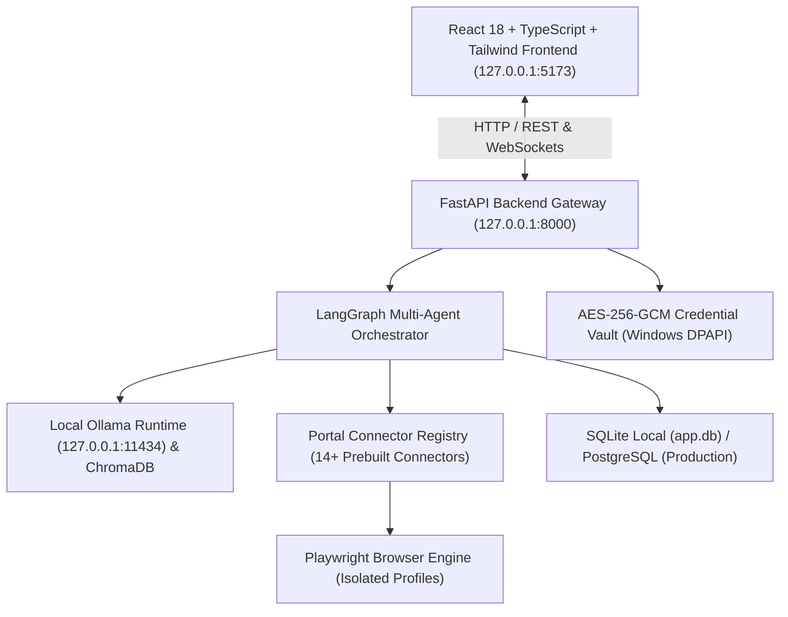

# Universal Local-First AI Job Search and Application Agent

[](https://www.python.org/downloads/)
[](https://fastapi.tiangolo.com)
[](https://langchain-ai.github.io/langgraph/)
[](https://ollama.ai)
[](https://react.dev)
[](https://www.typescriptlang.org/)
[](https://playwright.dev)
[](LICENSE)

An enterprise-grade, privacy-first autonomous multi-agent system engineered to streamline job discovery, resume optimization, ATS-compatibility scoring, automated browser application assistance, and personalized interview preparation.

Built for Windows 10/11 local execution with local Ollama inference, strict zero-data-leakage controls, and mandatory Human-in-the-Loop (HITL) application submission gates.

---

## 🌟 Key Highlights

- **🔒 Local-First & Zero Data Leakage**: Runs 100% locally on your computer with Ollama. Candidate resumes, credentials, and session cookies never leave your machine.
- **🛡️ Strict Anti-Hallucination Guardrails**: Resumes are customized and optimized for specific JDs without ever fabricating experience, skills, or credentials.
- **🔌 Universal Portal Connector Architecture**: Plugin-based engine supporting Indian job platforms (LinkedIn, Naukri, Foundit, Indeed, TimesJobs, Wellfound), international ATS systems (Greenhouse, Lever, Workday, SmartRecruiters, Ashby), and corporate career websites.
- **🔍 Universal Portal Discovery Agent**: Analyzes any job URL, detects the underlying ATS provider, evaluates form schema, and generates a capability matrix report.
- **🤖 8 Collaborative LangGraph Agents**: Orchestrated workflow with durable checkpointing, real-time WebSocket status streaming, and Human-in-the-Loop approval tokens.
- **🎯 Multi-Career Profile Engine**: One candidate can configure distinct target career profiles (e.g., Python Backend Architect, AI Engineering Lead, DevOps Engineer) matching different search criteria from a single master record.
- **🎙️ Interview Preparation & Spoken Coach**: Generates technical, HR, system design, coding, and scenario questions with simple-English explanations and first-person spoken scripts.
- **📊 Real-Time Application Tracking Dashboard**: Full Kanban and metric tracking across the entire hiring lifecycle.

---

## 🏗️ System Architecture Overview



---

## 📁 Repository Structure

```
ai-agent/
├── backend/                  # FastAPI 0.111+, SQLAlchemy 2.0, LangGraph, Playwright
│   ├── app/
│   │   ├── core/             # Security, AES-256-GCM vault, logging, exceptions
│   │   ├── db/               # SQLite/PostgreSQL models and session management
│   │   ├── ai/               # Ollama provider, local embeddings, ChromaDB RAG
│   │   ├── agents/           # 8 specialized LangGraph multi-agents
│   │   ├── connectors/       # Universal portal plugin connectors & discovery
│   │   ├── automation/       # Playwright browser manager & form detectors
│   │   ├── documents/        # PDF & DOCX parsers and ATS document generators
│   │   ├── schemas/          # Pydantic request and response models
│   │   └── api/              # REST endpoints & WebSocket streams
│   └── tests/                # Unit, integration, and security test suites
├── frontend/                 # React 18, TypeScript, Tailwind CSS, Vite
│   └── src/
│       ├── components/       # Common widgets, layouts, HITL approval modals
│       ├── pages/            # 15 specialized application pages & dashboards
│       ├── services/         # Typed API & WebSocket clients
│       └── store/            # Zustand global state stores
├── data/                     # Local-only persistent data directory
│   ├── db/                   # SQLite database file
│   ├── chroma/               # ChromaDB vector index
│   ├── vault/                # Encrypted credential store
│   ├── resumes/              # Original and tailored PDF/DOCX resumes
│   └── browser_profiles/     # Segregated Playwright browser sessions
├── docs/                     # Architectural specifications and design manuals
│   └── architecture/         # Detailed Phase 1 system designs
├── scripts/                  # Windows automation batch scripts
│   ├── start_backend.bat
│   ├── start_frontend.bat
│   ├── start_all.bat
│   └── stop_all.bat
└── docker/                   # Production containers & docker-compose
```

---

## 📑 Phase 1 Architectural Specifications

Detailed design documents generated during Phase 1:

1. [System Architecture](docs/architecture/system_architecture.md)
2. [Multi-Agent System & LangGraph State Machine](docs/architecture/multi_agent_system.md)
3. [Universal Portal Connector Architecture](docs/architecture/portal_connector_framework.md)
4. [Database Schema & ERD (17 Tables)](docs/architecture/database_schema_and_erd.md)
5. [Security Threat Model & Defense-in-Depth](docs/architecture/security_threat_model.md)
6. [Windows Local Execution Guide](docs/architecture/windows_local_execution.md)
7. [Implementation Roadmap (13 Phases)](docs/architecture/implementation_roadmap.md)

---

## 🚀 Quick Start (Windows)

### Prerequisites
- **Windows 10/11 64-bit**
- **Python 3.12+**: `python --version`
- **Node.js 20+ LTS**: `node -v`
- **Ollama**: Installed from [ollama.ai](https://ollama.ai)

### Pull Recommended Local Models
```cmd
ollama pull qwen2.5:7b-instruct
ollama pull nomic-embed-text
```

### Launch System
Double-click `scripts\start_all.bat` or run:
```cmd
scripts\start_all.bat
```
- Backend API Docs: `http://127.0.0.1:8000/docs`
- Web Dashboard: `http://localhost:5173`
