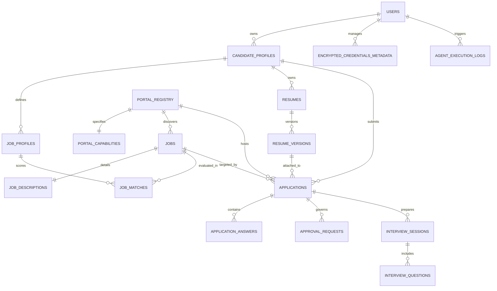

# Database Schema & Entity-Relationship Architecture

## 1. Overview & Dual Storage Architecture

The persistence model supports both **SQLite** (local development and offline-first single-user workflows) and **PostgreSQL** (production multi-user environments).

It uses **SQLAlchemy 2.0 Async ORM** and **Alembic** migrations. All tables use UUIDv4 primary keys for distributed compatibility.

---

## 2. Complete Entity-Relationship Diagram (17 Tables)

---

## 3. Comprehensive Table Specifications

### 1. `users`
- `id` (VARCHAR(36), PK): UUID.
- `username` (VARCHAR(64), UNIQUE, NOT NULL): Local user identifier.
- `email` (VARCHAR(255), UNIQUE, NOT NULL): User email.
- `hashed_password` (VARCHAR(255), NOT NULL): Argon2id salted password hash.
- `is_active` (BOOLEAN, DEFAULT TRUE): Account status.
- `created_at`, `updated_at` (TIMESTAMP WITH TIME ZONE).

### 2. `candidate_profiles`
- `id` (VARCHAR(36), PK): UUID.
- `user_id` (VARCHAR(36), FK -> `users.id` ON DELETE CASCADE).
- `first_name`, `last_name` (VARCHAR(100), NOT NULL).
- `email` (VARCHAR(255), NOT NULL).
- `phone` (VARCHAR(32)).
- `location_city`, `location_country` (VARCHAR(100)).
- `linkedin_url`, `github_url`, `portfolio_url` (VARCHAR(255)).
- `verified_skills` (JSON, NOT NULL): Array of authentic, verified skills.
- `verified_experience` (JSON, NOT NULL): Master chronological employment history.
- `verified_education` (JSON, NOT NULL): Master academic degrees and certifications.
- `created_at`, `updated_at` (TIMESTAMP WITH TIME ZONE).

### 3. `job_profiles`
- `id` (VARCHAR(36), PK): UUID.
- `candidate_profile_id` (VARCHAR(36), FK -> `candidate_profiles.id` ON DELETE CASCADE).
- `profile_name` (VARCHAR(100), NOT NULL): e.g. "Senior Python Architect".
- `target_job_titles` (JSON, NOT NULL): e.g. `["AI Engineer", "Backend Lead"]`.
- `target_skills` (JSON, NOT NULL): Priority skill focus for this role.
- `min_years_experience` (INTEGER, DEFAULT 0).
- `preferred_industries` (JSON): e.g. `["Fintech", "Healthtech"]`.
- `preferred_locations` (JSON): e.g. `["Bangalore", "San Francisco", "Remote"]`.
- `remote_preference` (VARCHAR(32), DEFAULT 'ANY'): `REMOTE`, `HYBRID`, `ONSITE`, `ANY`.
- `expected_salary_min` (NUMERIC(12, 2)), `expected_salary_currency` (VARCHAR(8)).
- `employment_type` (VARCHAR(32), DEFAULT 'FULL_TIME').
- `is_default` (BOOLEAN, DEFAULT FALSE).

### 4. `resumes`
- `id` (VARCHAR(36), PK): UUID.
- `candidate_profile_id` (VARCHAR(36), FK -> `candidate_profiles.id` ON DELETE CASCADE).
- `file_name` (VARCHAR(255), NOT NULL).
- `file_type` (VARCHAR(32), NOT NULL): `PDF`, `DOCX`.
- `raw_text` (TEXT, NOT NULL): Unstructured extracted resume text.
- `parsed_json` (JSON, NOT NULL): Structured schema-mapped content.
- `is_master` (BOOLEAN, DEFAULT TRUE).
- `created_at` (TIMESTAMP WITH TIME ZONE).

### 5. `resume_versions`
- `id` (VARCHAR(36), PK): UUID.
- `resume_id` (VARCHAR(36), FK -> `resumes.id` ON DELETE CASCADE).
- `job_id` (VARCHAR(36), FK -> `jobs.id` ON DELETE SET NULL).
- `version_label` (VARCHAR(100), NOT NULL): e.g. "Google - Senior Staff AI Engineer".
- `tailored_text` (TEXT, NOT NULL).
- `tailored_json` (JSON, NOT NULL).
- `pdf_file_path`, `docx_file_path` (VARCHAR(512)).
- `ats_score` (NUMERIC(5, 2)): Compatibility percentage.
- `grounding_verified` (BOOLEAN, DEFAULT TRUE): Passed anti-hallucination guardrail check.
- `created_at` (TIMESTAMP WITH TIME ZONE).

### 6. `portal_registry`
- `id` (VARCHAR(36), PK): UUID.
- `portal_id` (VARCHAR(64), UNIQUE, NOT NULL): e.g. `linkedin`, `naukri`, `greenhouse`.
- `name` (VARCHAR(128), NOT NULL).
- `category` (VARCHAR(64), NOT NULL): `INDIAN`, `INTERNATIONAL_ATS`, `COMPANY_CAREERS`.
- `base_url` (VARCHAR(255), NOT NULL).
- `connector_class` (VARCHAR(128), NOT NULL): Python class name in registry.
- `is_active` (BOOLEAN, DEFAULT TRUE).
- `created_at` (TIMESTAMP WITH TIME ZONE).

### 7. `portal_capabilities`
- `id` (VARCHAR(36), PK): UUID.
- `portal_registry_id` (VARCHAR(36), FK -> `portal_registry.id` ON DELETE CASCADE).
- `supports_search`, `supports_job_extraction`, `supports_form_detection` (BOOLEAN).
- `supports_resume_upload`, `supports_auto_fill`, `supports_direct_submit`, `supports_status_check` (BOOLEAN).
- `automation_level` (VARCHAR(32), NOT NULL): `LEVEL_1`, `LEVEL_2`, `LEVEL_3`, `LEVEL_4`.
- `requires_authentication` (BOOLEAN, DEFAULT FALSE).
- `security_restrictions` (JSON): Observed CAPTCHA, Cloudflare, MFA flags.

### 8. `jobs`
- `id` (VARCHAR(36), PK): UUID.
- `portal_id` (VARCHAR(36), FK -> `portal_registry.id`).
- `external_job_id` (VARCHAR(128)).
- `url` (VARCHAR(1024), UNIQUE, NOT NULL).
- `title`, `company_name` (VARCHAR(255), NOT NULL).
- `location`, `employment_type`, `salary_range` (VARCHAR(255)).
- `posted_date` (TIMESTAMP WITH TIME ZONE).
- `status` (VARCHAR(32), DEFAULT 'DISCOVERED'): `DISCOVERED`, `PROCESSED`, `APPLIED`, `ARCHIVED`.

### 9. `job_descriptions`
- `id` (VARCHAR(36), PK): UUID.
- `job_id` (VARCHAR(36), UNIQUE, FK -> `jobs.id` ON DELETE CASCADE).
- `raw_description` (TEXT, NOT NULL).
- `extracted_mandatory_skills` (JSON, NOT NULL).
- `extracted_optional_skills` (JSON, NOT NULL).
- `extracted_experience_years` (NUMERIC(4, 1)).
- `extracted_responsibilities` (JSON).
- `extracted_ats_keywords` (JSON, NOT NULL).
- `extracted_interview_topics` (JSON).

### 10. `job_matches`
- `id` (VARCHAR(36), PK): UUID.
- `job_profile_id` (VARCHAR(36), FK -> `job_profiles.id` ON DELETE CASCADE).
- `job_id` (VARCHAR(36), FK -> `jobs.id` ON DELETE CASCADE).
- `overall_match_score`, `skills_match_score`, `experience_match_score` (NUMERIC(5, 2)).
- `missing_skills`, `matching_skills` (JSON).

### 11. `applications`
- `id` (VARCHAR(36), PK): UUID.
- `job_id` (VARCHAR(36), FK -> `jobs.id`).
- `candidate_profile_id` (VARCHAR(36), FK -> `candidate_profiles.id`).
- `resume_version_id` (VARCHAR(36), FK -> `resume_versions.id`).
- `portal_id` (VARCHAR(36), FK -> `portal_registry.id`).
- `status` (VARCHAR(32), DEFAULT 'DRAFT'): `DRAFT`, `PREPARED`, `AWAITING_APPROVAL`, `SUBMITTED`, `REJECTED`, `INTERVIEW`, `OFFER`.
- `submission_mode` (VARCHAR(32), NOT NULL): `AUTOMATED`, `ASSISTED_MANUAL`, `MANUAL`.
- `applied_at` (TIMESTAMP WITH TIME ZONE).
- `confirmation_reference` (VARCHAR(255)).
- `notes` (TEXT).

### 12. `application_answers`
- `id` (VARCHAR(36), PK): UUID.
- `application_id` (VARCHAR(36), FK -> `applications.id` ON DELETE CASCADE).
- `field_identifier`, `field_label`, `field_type` (VARCHAR).
- `generated_answer`, `final_answer` (TEXT, NOT NULL).
- `is_sensitive`, `user_confirmed` (BOOLEAN).

### 13. `interview_sessions`
- `id` (VARCHAR(36), PK): UUID.
- `application_id` (VARCHAR(36), FK -> `applications.id` ON DELETE SET NULL).
- `job_id` (VARCHAR(36), FK -> `jobs.id`).
- `session_title`, `interview_type` (VARCHAR).
- `overall_feedback` (TEXT).

### 14. `interview_questions`
- `id` (VARCHAR(36), PK): UUID.
- `interview_session_id` (VARCHAR(36), FK -> `interview_sessions.id` ON DELETE CASCADE).
- `category` (VARCHAR(64), NOT NULL): `HR`, `TECHNICAL`, `CODING`, `SCENARIO`, `PROJECT`.
- `question_text`, `context_reference` (TEXT).
- `detailed_explanation` (TEXT, NOT NULL): Simple-English conceptual breakdown.
- `spoken_answer_script` (TEXT, NOT NULL): Ready-to-speak phrasing.
- `follow_up_questions` (JSON).

### 15. `agent_execution_logs`
- `id` (VARCHAR(36), PK): UUID.
- `agent_name`, `action`, `inputs_hash`, `status` (VARCHAR).
- `execution_time_ms` (INTEGER).
- `log_details` (JSON).

### 16. `approval_requests`
- `id` (VARCHAR(36), PK): UUID.
- `application_id` (VARCHAR(36), FK -> `applications.id` ON DELETE CASCADE).
- `request_type`, `status` (VARCHAR).
- `payload_preview` (JSON, NOT NULL): Exact fields and attachments for review.
- `approval_token` (VARCHAR(255), UNIQUE).
- `approved_at`, `expires_at` (TIMESTAMP WITH TIME ZONE).

### 17. `encrypted_credentials_metadata`
- `id` (VARCHAR(36), PK): UUID.
- `user_id` (VARCHAR(36), FK -> `users.id` ON DELETE CASCADE).
- `service_name`, `key_identifier` (VARCHAR).
- `encrypted_blob` (TEXT, NOT NULL): AES-256-GCM ciphertext.
- `iv_salt` (VARCHAR(128), NOT NULL).
