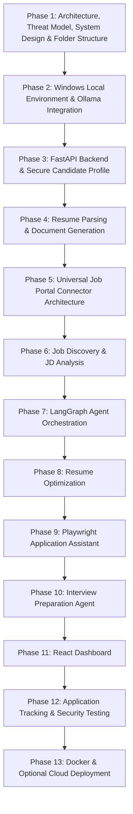

# Implementation Roadmap: 13 Phases

This document defines the milestone schedule, exact deliverables, and validation exit criteria for each phase.

---

## Detailed Phase Breakdown

### Phase 1: Architecture, Threat Model, System Design & Folder Structure *(Current)*
- **Deliverables**: System architecture, 8-agent LangGraph workflow, 4-level portal connector architecture, 17-table database schema/ERD, STRIDE threat model, Windows execution plan, repository folder hierarchy, `.gitignore`, `.env.example`, `README.md`.
- **Validation**: All architecture documents verified, directory layout established, and design approved.

### Phase 2: Windows Local Environment & Ollama Integration
- **Deliverables**: Python 3.12 virtualenv setup, `requirements.txt`, Node.js setup, Ollama provider abstraction, model health check endpoint, offline fallback handler.
- **Validation**: Local test script executes inference against local Ollama without errors; graceful error handling when Ollama is offline.

### Phase 3: FastAPI Backend & Secure Candidate Profile
- **Deliverables**: FastAPI factory, async SQLAlchemy database engine (SQLite/PostgreSQL), Alembic migrations for initial tables, candidate profile CRUD, multi-career profile manager, AES-256-GCM encrypted vault.
- **Validation**: REST API unit tests for candidate profiles, multiple job profiles, and credential encryption/decryption pass.

### Phase 4: Resume Parsing & Document Generation
- **Deliverables**: PDF & DOCX parser with section detection (skills, experience, education, projects), ATS-compliant PDF generator (ReportLab), and DOCX generator (python-docx).
- **Validation**: Resumes are parsed into structured JSON and re-rendered into clean, ATS-scannable PDF and DOCX files.
- **Status**: Complete, including upload size/MIME/signature validation and grounded resume-version handling.

### Phase 5: Universal Job Portal Connector Architecture
- **Deliverables**: `JobPortalConnector` ABC, `PortalRegistry`, prebuilt connectors for Indian platforms (LinkedIn, Naukri, Foundit, Indeed) and ATS systems (Greenhouse, Lever, Workday), and Universal Portal Discovery Agent with capability reporting.
- **Validation**: Discovery engine inspects unknown URLs and generates accurate capability reports; registry loads plugins dynamically.

### Phase 6: Job Discovery & JD Analysis
- **Deliverables**: Agent 1 (Job Discovery) multi-portal query executor, deduplication engine, and Agent 3 (JD Analysis) deep keyword/skill extractor and compatibility scoring.
- **Validation**: Job search returns clean listings; JD parser extracts mandatory/optional skills and calculates compatibility score accurately.

### Phase 7: LangGraph Agent Orchestration
- **Deliverables**: Centralized `JobSearchAppState`, LangGraph state graph composing the implemented discovery, portal inspection, JD analysis, and compatibility agents, conditional edges, cycle limits, and checkpointed Human-in-the-Loop interruption engine. Later-phase agents join the graph as they are implemented.
- **Validation**: Full agent state execution cycle executes, records state transitions, and halts cleanly before irreversible actions.
- **Implementation details**: See [Phase 7 orchestration](../phase_7_langgraph_orchestration.md) for available graph modes, checkpointing, API routes, and the human-review boundary.

### Phase 8: Resume Optimization Agent
- **Deliverables**: Agent 5 (Resume Optimizer) tailoring engine using the XYZ formula, ATS keyword injection, and strict anti-hallucination verification engine.
- **Validation**: Tailored resume matches target JD; verification rejects any claims or skills not present in master facts.
- **Implementation**: Deterministic optimizer, supported only by verified candidate/resume facts, with structured grounding reports and rendered PDF/DOCX resume versions.
- **Documentation**: See [Phase 8 resume optimization](../phase_8_resume_optimization.md).

### Phase 9: Playwright Application Assistant
- **Deliverables**: Isolated browser context manager, heuristic form detector, auto-filler, file uploader, and cryptographic single-use HITL approval gate.
- **Validation**: Automated form filling tested on a local mock career site; stops at final submit button and executes only when valid approval token is supplied.
- **Implementation**: See [Phase 9 Playwright application assistant](../phase_9_playwright_application_assistant.md).

### Phase 10: Interview Preparation Agent
- **Deliverables**: Agent 7 (Interview Prep) question generator (technical, behavioral, coding, scenario, project), simple-English explanations, spoken scripts, and interactive mock interview session engine.
- **Validation**: Questions and spoken scripts generated accurately based on candidate resume and target JD.

### Phase 11: React Dashboard & Frontend
- **Deliverables**: React 18 + TypeScript + Tailwind UI with all 15 specialized pages (Dashboard, Profiles, Resumes, Search, Registry, Portal Inspector, JD Analyzer, Resume Optimizer, Application Assistant, Interview Prep, Mock Interview, Tracker, Settings, Vault).
- **Validation**: Frontend communicates with backend REST & WebSocket endpoints smoothly.

### Phase 12: Application Tracking & Security Testing
- **Deliverables**: Agent 8 (Application Tracker) Kanban board, audit logs, comprehensive security test suite (prompt injection defense, credential isolation, PII leakage prevention).
- **Validation**: All security penetration tests pass; application status changes update in real-time.

### Phase 13: Docker & Optional Cloud Deployment
- **Deliverables**: Multi-stage `Dockerfile.backend` and `Dockerfile.frontend`, `docker-compose.yml` (PostgreSQL, Redis, Backend, Frontend), Railway/cloud deployment documentation.
- **Validation**: Full stack builds and runs cleanly via Docker Compose.
