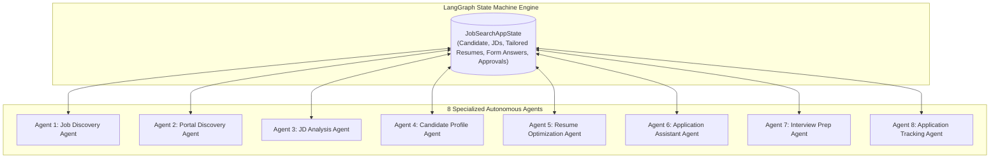

# Multi-Agent System & LangGraph State Machine Specification

## 1. Multi-Agent System Overview

The application coordinates 8 specialized autonomous agents using **LangGraph**. The workflow utilizes a single unified, typed state object (`JobSearchAppState`), deterministic routing functions, cycle prevention counters, and durable Human-in-the-Loop (HITL) checkpoints.



---

## 2. Detailed Agent Specifications

### Agent 1: Job Discovery Agent
- **Goal**: Search across enabled job portals (LinkedIn, Naukri, Greenhouse, Lever, etc.) matching the candidate's active `JobProfile`.
- **Inputs**: Active `JobProfile` (target titles, skills, locations, remote preference, min experience).
- **Outputs**: List of deduplicated, normalized `JobListing` objects added to state.
- **Key Logic**: Builds structured query payloads for each registered connector, triggers concurrent searches, hashes URL + Company + Title to filter duplicates, and records listings in the database.

### Agent 2: Portal Discovery Agent
- **Goal**: Analyze arbitrary job URLs provided by the user, detect underlying recruitment infrastructure, and determine integration feasibility.
- **Inputs**: Target URL string.
- **Outputs**: Comprehensive `PortalCapabilityReport`.
- **Key Logic**: Fetches page via headless browser, analyzes DOM scripts, meta tags, network requests, and form action attributes. Identifies ATS signatures (Greenhouse, Lever, Workday, etc.). Evaluates form fields and upload support.

### Agent 3: JD Analysis Agent
- **Goal**: Deep semantic extraction of job description text into actionable structured criteria.
- **Inputs**: Raw job description string or URL.
- **Outputs**: Structured `JobDescriptionAnalysis` (mandatory skills, optional skills, years of experience, core responsibilities, ATS keywords, interview focus topics, candidate match score).
- **Key Logic**: Uses local Ollama with structured JSON schema output. Compares extracted skill vectors against active candidate skills using cosine similarity.

### Agent 4: Candidate Profile Agent
- **Goal**: Master data management for the candidate's authentic career history, education, skills, and multiple targeted career profiles.
- **Inputs**: User input, verified past resumes, profile updates.
- **Outputs**: Verified master profile and specialized `JobProfile` configurations.
- **Key Logic**: Segregates verified commercial experience from personal/academic projects. Validates chronological consistency and enforces data immutability for unverified claims.

### Agent 5: Resume Optimization Agent
- **Goal**: Dynamically tailor resume summary, project descriptions, and skill order for a specific target job posting.
- **Inputs**: Master candidate profile + analyzed JD.
- **Outputs**: ATS-optimized tailored resume data, grounding verification report, rendered PDF and DOCX files.
- **Strict Anti-Hallucination Guardrail**:
  1. Compares every optimized accomplishment bullet against the candidate's verified master facts.
  2. Any newly introduced technology, certification, or numerical metric not present in master facts triggers an immediate re-write loop.
  3. Formats keywords naturally into accomplishment statements using the **Google XYZ formula**: *"Accomplished [X], as measured by [Y], by doing [Z]"*.

### Agent 6: Application Assistant Agent
- **Goal**: Assist the user in filling portal application forms and uploading tailored documents using Playwright.
- **Inputs**: Target job, tailored resume file, generated application answers.
- **Outputs**: Prefilled form ready for review, submission confirmation reference.
- **Mandatory Human-in-the-Loop Approval Gate**:
  - Halts execution immediately before clicking the final submit button.
  - Emits a WebSocket event with a complete visual preview of all filled fields and attached documents.
  - Requires a cryptographic, time-limited single-use user approval token (`approval_token`) to proceed.

### Agent 7: Interview Preparation Agent
- **Goal**: Generate comprehensive interview coaching materials customized to the specific company, JD, and the candidate's actual resume projects.
- **Inputs**: Analyzed JD + tailored resume version.
- **Outputs**: Question bank categorized into HR/Behavioral, Technical/Architectural, Coding, Scenario, and Project-deep-dive.
- **Features**:
  - Simple-English conceptual breakdowns explaining what the interviewer is evaluating.
  - First-person natural spoken answers ready for vocal practice.
  - Interactive Mock Interview mode with simulated audio/text evaluation.

### Agent 8: Application Tracking Agent
- **Goal**: Lifecycle state machine managing every application from discovery through offer/rejection.
- **Inputs**: Status transitions, user updates, automated status check polls.
- **Outputs**: Application status timeline, dashboard KPIs, follow-up reminders.

---

## 3. LangGraph State Schema (`JobSearchAppState`)

```python
from typing import TypedDict, List, Dict, Any, Optional
from datetime import datetime

class JobSearchAppState(TypedDict):
    # Session metadata
    session_id: str
    user_id: str
    active_job_profile_id: str
    
    # Discovery state
    discovered_jobs: List[Dict[str, Any]]
    selected_job_id: Optional[str]
    current_portal_report: Optional[Dict[str, Any]]
    
    # Analysis state
    raw_jd_text: Optional[str]
    analyzed_jd: Optional[Dict[str, Any]]
    compatibility_score: Optional[float]
    
    # Candidate & Resume state
    candidate_master_facts: Dict[str, Any]
    active_resume_version_id: Optional[str]
    tailored_resume_data: Optional[Dict[str, Any]]
    grounding_verified: bool
    generated_pdf_path: Optional[str]
    generated_docx_path: Optional[str]
    
    # Application & HITL Approval state
    application_id: Optional[str]
    prefilled_form_fields: Dict[str, Any]
    approval_token: Optional[str]
    approval_status: str  # "IDLE", "AWAITING_REVIEW", "APPROVED", "REJECTED"
    submission_confirmation: Optional[Dict[str, Any]]
    
    # Interview Prep state
    interview_session_id: Optional[str]
    interview_questions: List[Dict[str, Any]]
    
    # Execution & Audit
    current_agent: str
    error_message: Optional[str]
    iteration_count: int
```

---

## 4. Human-In-The-Loop (HITL) Interruption Mechanics

LangGraph enables persistent checkpointing with built-in interruption:

```python
# Graph compilation with HITL interruption before irreversible actions
workflow = StateGraph(JobSearchAppState)

# Define nodes for agents
workflow.add_node("job_discovery", discovery_agent_node)
workflow.add_node("jd_analysis", jd_analysis_node)
workflow.add_node("resume_optimizer", resume_optimizer_node)
workflow.add_node("form_prefiller", form_prefiller_node)
workflow.add_node("await_human_approval", hitl_approval_gate_node)
workflow.add_node("submit_application", application_submitter_node)

# Compile graph with interruption
app_graph = workflow.compile(
    checkpointer=SqliteSaver.from_conn_string("./data/db/checkpoints.db"),
    interrupt_before=["submit_application"]
)
```

When execution reaches `submit_application`, the graph pauses. The UI receives the snapshot, renders the approval modal, and only resumes after the candidate clicks **Approve & Submit**.
