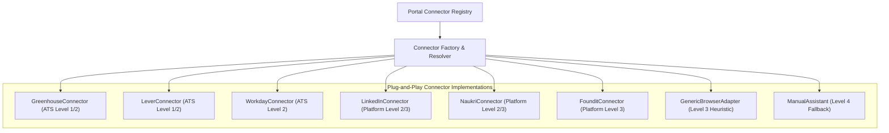

# Universal Career Portal Connector Framework

## 1. Architectural Overview

The Universal Career Portal Connector Framework provides a plugin-based system for interacting with job boards, Applicant Tracking Systems (ATS), and corporate career websites.

It enforces a strict separation between core business logic and portal-specific implementations, enabling new connectors to be created and registered without altering existing code.



---

## 2. Core Abstract Interface: `JobPortalConnector`

Every connector must inherit from `JobPortalConnector` and implement all 11 required methods:

```python
from abc import ABC, abstractmethod
from typing import List, Dict, Any, Optional
from pathlib import Path
from pydantic import BaseModel

class PortalCapabilities(BaseModel):
    supports_search: bool = False
    supports_job_extraction: bool = True
    supports_form_detection: bool = True
    supports_resume_upload: bool = False
    supports_auto_fill: bool = False
    supports_direct_submit: bool = False
    supports_status_check: bool = False
    automation_level: str  # "LEVEL_1", "LEVEL_2", "LEVEL_3", "LEVEL_4"
    requires_authentication: bool = False
    security_restrictions: List[str] = []

class JobPortalConnector(ABC):
    portal_id: str
    name: str
    base_urls: List[str]
    capabilities: PortalCapabilities

    @abstractmethod
    async def identify_portal(self, url: str) -> bool:
        """Determines if the given URL belongs to or is hosted by this portal."""
        pass

    @abstractmethod
    async def check_support(self, url: str) -> PortalCapabilities:
        """Evaluates operational support and restrictions for the given URL."""
        pass

    @abstractmethod
    async def authenticate(self, credentials: Dict[str, Any]) -> bool:
        """Handles authentication using encrypted credentials or saved session."""
        pass

    @abstractmethod
    async def search_jobs(self, query: Dict[str, Any]) -> List[Dict[str, Any]]:
        """Searches for jobs matching role, location, and experience criteria."""
        pass

    @abstractmethod
    async def extract_job_details(self, target: str) -> Dict[str, Any]:
        """Extracts structured metadata (title, company, salary, location, JD)."""
        pass

    @abstractmethod
    async def extract_job_description(self, target: str) -> str:
        """Extracts clean, unformatted raw job description text."""
        pass

    @abstractmethod
    async def prepare_application(self, job_id: str, profile_data: Dict[str, Any]) -> Dict[str, Any]:
        """Pre-maps candidate profile data to portal form fields."""
        pass

    @abstractmethod
    async def fill_application(self, form_data: Dict[str, Any]) -> bool:
        """Fills detected form fields using browser automation."""
        pass

    @abstractmethod
    async def upload_resume(self, file_path: Path) -> bool:
        """Uploads tailored resume document to the application file input."""
        pass

    @abstractmethod
    async def validate_application(self) -> Dict[str, Any]:
        """Validates that all mandatory fields are filled and errors are cleared."""
        pass

    @abstractmethod
    async def submit_application(self, approval_token: str) -> Dict[str, Any]:
        """Submits the application form after validating the human approval token."""
        pass

    @abstractmethod
    async def get_application_status(self, app_id: str) -> Dict[str, Any]:
        """Checks latest status of a submitted application if supported."""
        pass
```

---

## 3. Four-Tier Integration Strategy

1. **Level 1: Official API**
   - High speed, zero HTML brittleness.
   - Used when authorized public/partner endpoints exist (e.g. Greenhouse Harvest/Job Board API, Lever Postings API).
2. **Level 2: ATS-Specific Integration**
   - Targeted Playwright automation for standardized recruitment engines.
   - Tailored selectors and handling for Greenhouse (`boards.greenhouse.io`), Lever (`jobs.lever.co`), Workday (`myworkdayjobs.com`), SmartRecruiters, Ashby, iCIMS, Taleo.
3. **Level 3: Generic Browser Adapter**
   - Heuristic Playwright automation engine.
   - Inspects form elements, ARIA labels, `<input>`, `<textarea>`, and `<select>` tags using semantic matching.
4. **Level 4: Manual Assistance Fallback**
   - Activated when bot mitigation (Cloudflare Turnstile, reCAPTCHA, Datadome, MFA) blocks automation.
   - Extracts JD, customizes resume, prepares answers, and provides an interactive side-by-side submission assistant for the user to submit manually in seconds.

---

## 4. Unknown Portal Discovery & Capability Matrix

When a user submits an unfamiliar URL, the **Portal Discovery Agent** executes:

1. **URL & Domain Parsing**: Checks domain against known registries and CDN headers.
2. **DOM Fingerprinting**: Scans scripts for ATS markers (`gh_jid`, `lever-jobs-embed`, `workday-app`).
3. **Form Schema Extraction**: Identifies file inputs (`type="file"`), text inputs, dropdowns, and CSRF tokens.
4. **Security Barrier Inspection**: Detects CAPTCHA iframes, bot challenge scripts, or login walls.
5. **Capability Report Generation**: Emits a structured JSON assessment indicating which features (Extraction, Auto-fill, Resume Upload, Submit) can be safely executed.

```json
{
  "portal_name": "Acme Careers (Greenhouse)",
  "canonical_url": "https://boards.greenhouse.io/acmecorp/jobs/54321",
  "detected_ats": "Greenhouse",
  "integration_level": "LEVEL_2_ATS",
  "capabilities": {
    "job_extraction": true,
    "form_detection": true,
    "resume_upload": true,
    "auto_fill": true,
    "direct_submit": true,
    "status_check": false
  },
  "security_restrictions": {
    "captcha_detected": false,
    "auth_required": false
  },
  "recommended_approach": "Automated fill via Greenhouse DOM adapter with final HITL confirmation."
}
```
