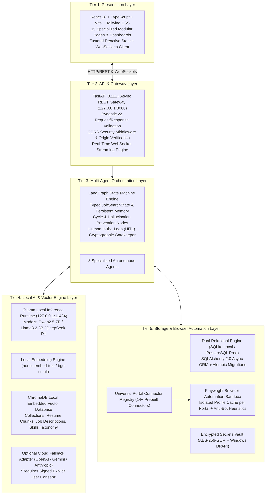

# System Architecture: Universal Local-First AI Job Search and Application Agent

## 1. Architectural Philosophy

The **Universal Local-First AI Job Search and Application Agent** is designed as a secure, local-first, highly extensible autonomous system. The architecture guarantees:

1. **Zero-Data-Leakage Local Processing**: Sensitive candidate data, resumes, portal credentials, and browsing sessions are stored and processed strictly on the user's host machine.
2. **Decoupled 5-Tier Architecture**: Clear separation of concerns between presentation, orchestration, multi-agent intelligence, local AI/vector stores, and storage/automation engines.
3. **Plug-and-Play Extensibility**: Career portal connectors, LLM providers, and document generators can be added, updated, or swapped without changing core business logic.
4. **Resilient Failure Modes**: Network dropouts, anti-bot challenges, or unavailable LLM models are handled gracefully through fallbacks, offline queues, and interactive assisted modes.

---

## 2. Five-Tier System Topology

---

## 3. Communication Protocols and Boundaries

| Boundary | Transport | Data Format | Security Controls |
| :--- | :--- | :--- | :--- |
| **Frontend $\leftrightarrow$ Backend** | HTTP/1.1 & WebSockets | JSON / Protobuf / Binary PDF | Bound to `127.0.0.1`, strict CORS origin `localhost:5173`, CSRF token headers. |
| **Backend $\leftrightarrow$ Ollama** | HTTP (REST) | JSON (Ollama API format) | Internal localhost connection only (`127.0.0.1:11434`). Timeouts & circuit breakers. |
| **Backend $\leftrightarrow$ ChromaDB** | In-Process Python SDK | Native PyArrow / NumPy | File-level permissions inside `./data/chroma`. |
| **Backend $\leftrightarrow$ Playwright** | Node/Python IPC Bridge | CDP (Chrome DevTools Protocol) | Bound to ephemeral internal IPC pipes; debugging ports never exposed externally. |
| **Playwright $\leftrightarrow$ Public Portals** | HTTPS | HTML, DOM, HTTP Headers | Standard TLS, isolated browser cookies per portal, user-agent rotation. |

---

## 4. Local vs Production Architectural Differences

| Subsystem | Local Development Mode (Default) | Production / Cloud Deployment |
| :--- | :--- | :--- |
| **Database** | SQLite via `aiosqlite` (`./data/db/app.db`) | PostgreSQL 16+ via `asyncpg` |
| **AI Inference** | Local Ollama (`http://127.0.0.1:11434`) | Dedicated vLLM/Ollama host or enterprise cloud API |
| **Vector Storage** | Local ChromaDB embedded directory | Distributed ChromaDB / pgvector / Qdrant |
| **Credentials Vault**| Local AES-256-GCM + Windows DPAPI | HashiCorp Vault or AWS KMS / Azure Key Vault |
| **Browser Execution**| Local Playwright with headful window option | Headless Playwright running in Docker sidecar container |
| **Task Queue** | Python `asyncio` background tasks | Redis + Celery / ARQ asynchronous queue |

---

## 5. Resilience & Fault Tolerance Mechanisms

1. **Ollama Availability Heartbeat**: If the local Ollama service is stopped or restarting, the backend does not crash. It transitions to `DEGRADED_LOCAL` mode, returns actionable error prompts to the UI, and pauses active agent workflows safely.
2. **Form Automation Fail-Safe**: If an unexpected DOM mutation, dynamic iframe, or CAPTCHA appears during Playwright automation, the browser pauses execution, takes an annotated screenshot, and transfers control to the user via **Level 4 Assisted Manual Mode**.
3. **Database Write Integrity**: SQLite is configured with Write-Ahead Logging (`PRAGMA journal_mode=WAL`) and `PRAGMA synchronous=NORMAL`, preventing database corruption during abrupt process terminations.
