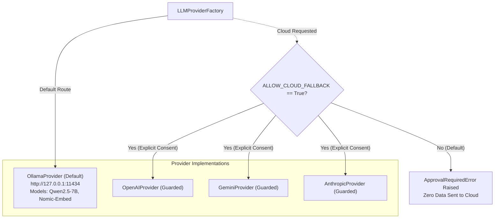

# Phase 2: Windows Local Environment & Ollama Integration

## 1. Overview & Objectives

Phase 2 establishes the local-first execution environment and AI inference subsystem:
1. **Isolated Virtual Environment**: Setup `.venv` to prevent interference with system packages.
2. **Local Ollama Integration**: Native Windows Ollama runtime (`http://127.0.0.1:11434`) as the default inference engine.
3. **Pluggable LLM Provider Abstraction**: `BaseLLMProvider` interface with concrete implementations for `OllamaProvider` and guarded cloud stubs (`OpenAIProvider`, `GeminiProvider`, `AnthropicProvider`).
4. **Strict Zero-Silent-Fallback Guardrail**: The system will never silently redirect requests or candidate data to external cloud services if Ollama is unavailable. It reports descriptive, actionable errors.
5. **Local Embeddings & ChromaDB**: `LocalEmbeddingEngine` generating vector representations via `nomic-embed-text` and storing in `./data/chroma`.
6. **AI Model Settings & Health Checks**: REST endpoints for real-time model health queries, latency measurement, installed model discovery, and dynamic model switching.

---

## 2. Windows Environment Setup Guide

### Automatic Setup (One-Click)
Open PowerShell or Command Prompt as Administrator and run:
```cmd
scripts\setup_env.bat
```
This automatically verifies Python 3.12, installs Ollama, downloads default models, creates `.venv`, installs dependencies, and configures Playwright.

### Manual Setup Step-by-Step

#### 1. Python 3.12+
```powershell
winget install Python.Python.3.12 --accept-package-agreements
```
Or download from [python.org/downloads/](https://www.python.org/downloads/) (ensure **"Add Python to PATH"** is checked).

#### 2. Node.js 20+ LTS
```powershell
winget install OpenJS.NodeJS.LTS --accept-package-agreements
```

#### 3. Ollama for Windows
```powershell
winget install Ollama.Ollama --accept-package-agreements
```
Or download from [ollama.ai/download/windows](https://ollama.ai/download/windows).

#### 4. Pull Local Models
```powershell
ollama pull qwen2.5:7b-instruct
ollama pull nomic-embed-text
```

#### 5. Virtual Environment & Dependencies
```powershell
python -m venv .venv
.\.venv\Scripts\activate
python -m pip install --upgrade pip
pip install -r backend\requirements.txt
playwright install chromium
```

---

## 3. Provider Abstraction Architecture



---

## 4. API Endpoints for AI Model Management

| Method | Endpoint | Description |
| :--- | :--- | :--- |
| `GET` | `/health` | Heartbeat checking application status and local mode flag. |
| `GET` | `/api/v1/models/health` | Comprehensive provider ping, latency test, model availability. |
| `GET` | `/api/v1/models/ollama/list` | Returns installed Ollama models with parameter sizes and disk usage. |
| `POST` | `/api/v1/models/ollama/pull` | Initiates background download of a new Ollama model. |
| `POST` | `/api/v1/models/select` | Dynamically updates active reasoning or embedding model. |
| `GET` | `/api/v1/models/settings` | Returns active LLM configurations and privacy controls. |

---

## 5. Verification & Testing

Unit and integration tests verify:
1. `test_ollama_health_check_offline`: Confirms actionable error when Ollama is offline.
2. `test_ollama_health_check_online_with_model`: Confirms latency measurement and model detection.
3. `test_cloud_provider_strict_guardrail_blocks_silent_fallback`: Confirms zero private data transfer without consent.
4. `test_provider_factory_resolution`: Confirms dynamic model selection.
5. `test_models_api`: Confirms all REST model management endpoints respond with HTTP 200.
