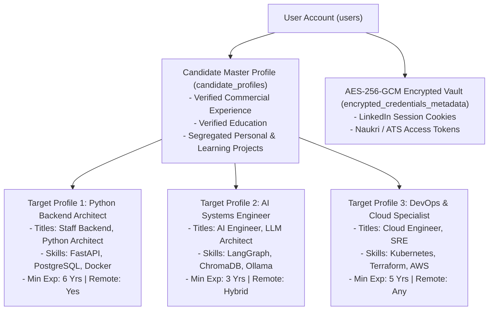

# Phase 3: FastAPI Backend & Secure Candidate Profile

## 1. Overview & Architecture

Phase 3 implements the persistence and candidate identity management layer for the **Universal Local-First AI Job Search and Application Agent**:

1. **Async Relational Layer**: SQLAlchemy 2.0 Async ORM with Alembic migration scaffolding. Supports local SQLite via `aiosqlite` (with WAL mode enabled) and production PostgreSQL via `asyncpg`.
2. **Candidate Master Profile Engine**: Stores verified facts (skills, employment history, academic credentials). Enforces strict separation between verified commercial experience and non-commercial learning/personal projects.
3. **Universal Multi-Career Profile Engine**: Allows a single candidate to configure multiple targeted career profiles (e.g. "Senior Python Architect" vs "AI Agent Engineer" vs "DevOps Lead") with independent titles, skills, salary, and remote preferences.
4. **AES-256-GCM Encrypted Vault**: Encrypts portal cookies, credentials, and API tokens with AES-256-GCM authenticated encryption using keys derived via PBKDF2 (600,000 iterations).

---

## 2. Multi-Profile Candidate Topology

---

## 3. Implemented Database Models

| Model | Table | Purpose |
| :--- | :--- | :--- |
| `User` | `users` | Local authentication identity with Argon2id salted password hashing. |
| `CandidateProfile` | `candidate_profiles` | Candidate master identity, contact details, verified skills, and experience ground truth. |
| `JobProfile` | `job_profiles` | Targeted career profiles with distinct criteria and default selection flag. |
| `EncryptedCredentialsMetadata` | `encrypted_credentials_metadata` | AES-256-GCM ciphertext, salt, and nonce for sensitive secrets. |

---

## 4. API Endpoints Reference

### Candidate Master Profile (`/api/v1/candidates`)
- `POST /api/v1/candidates/`: Create new candidate profile with verified facts.
- `GET /api/v1/candidates/`: List candidate profiles.
- `GET /api/v1/candidates/{id}`: Retrieve profile by ID.
- `PUT /api/v1/candidates/{id}`: Update profile information.
- `DELETE /api/v1/candidates/{id}`: Delete profile.

### Target Career Profiles (`/api/v1/job-profiles`)
- `GET /api/v1/job-profiles/categories/list`: Returns 25+ universal job role categories.
- `POST /api/v1/job-profiles/`: Create targeted career profile.
- `GET /api/v1/job-profiles/candidate/{candidate_id}`: List all targeted profiles for a candidate.
- `GET /api/v1/job-profiles/{profile_id}`: Get specific profile.
- `PUT /api/v1/job-profiles/{profile_id}`: Update profile criteria.
- `POST /api/v1/job-profiles/{profile_id}/set-default`: Switch active default profile.
- `DELETE /api/v1/job-profiles/{profile_id}`: Delete targeted profile.

### Encrypted Vault (`/api/v1/vault`)
- `POST /api/v1/vault/store`: Encrypt and store sensitive credentials.
- `POST /api/v1/vault/retrieve`: Decrypt and return credentials.
- `GET /api/v1/vault/list`: List secret metadata without exposing plaintext.
- `DELETE /api/v1/vault/{secret_id}`: Permanently delete stored secret.

---

## 5. Verification & Testing

The test suite validates:
1. `test_password_hashing_and_verification`: Argon2id hash derivation and verification.
2. `test_aes_256_gcm_vault_encryption_decryption`: Cryptographic round-trip encryption/decryption.
3. `test_aes_256_gcm_vault_rejects_wrong_key`: Wrong passphrase rejection.
4. `test_aes_256_gcm_vault_detects_tampering`: Tamper-evident authentication tag rejection.
5. `test_candidate_profile_schema_segregation`: Separation of commercial and personal learning projects.
6. `test_multi_job_profile_configurations`: Multi-role configuration per candidate.
7. `test_candidate_profile_and_multi_job_profile_lifecycle`: Full end-to-end integration test of candidate profile creation, multiple targeted job profiles, default switching, and vault store/retrieve operations.
