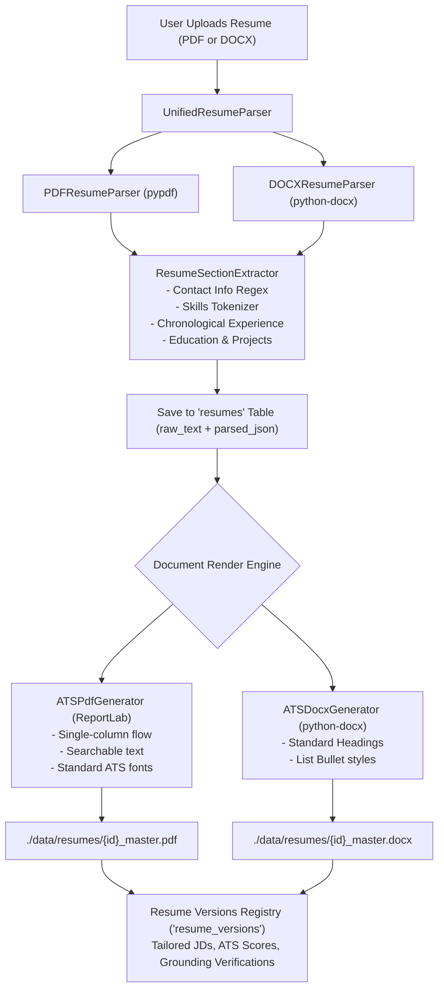

# Phase 4: Resume Parsing & Document Generation

> Phase status: Complete. In the application's 11-phase sequence this
> corresponds to Phase 3. The implementation also enforces upload size/MIME
> checks, PDF/DOCX signatures, structured education/project/certification
> parsing, grounded resume-version verification, and generated-file cleanup.

## 1. Overview & Architectural Goals

Phase 4 implements the document intelligence and document generation layer for the **Universal Local-First AI Job Search and Application Agent**:

1. **Dual Document Parsing**: Extracts raw text, structural hierarchy, and tables from both PDF (`pypdf`) and Word (`python-docx`) documents.
2. **Semantic Section Extraction**: Segments unstructured resume text into standardized sections: Contact Info, Professional Summary, Technical Skills, Chronological Experience, Academic Education, Projects, and Certifications.
3. **ATS-Compliant PDF Generation**: Uses `ReportLab` to construct clean, single-column, selectable PDFs that score 90%+ on automated ATS parsers (e.g. Greenhouse, Workday, Lever, Taleo) without multi-column layout artifacts.
4. **ATS-Compliant DOCX Generation**: Uses `python-docx` to construct professional, editable Word documents using standard heading hierarchies and bullet styles.
5. **Resume Versioning & Lineage**: The `resumes` and `resume_versions` tables track every tailored variant created for specific job postings, preserving full document history.

---

## 2. Document Processing & Generation Pipeline

---

## 3. ATS Optimization Standards Enforced

| ATS Feature | Implementation Standard | Why It Matters |
| :--- | :--- | :--- |
| **Layout** | Strict single-column flowable layout | Multi-column layouts scramble text when read by ATS text extraction engines. |
| **Typography** | Standard web/system fonts (Helvetica, Arial, Times-Roman) | Non-standard or embedded font glyphs often extract as garbled unicode characters. |
| **Separators** | Thin horizontal rules (`HRFlowable`) | Avoids using graphical image lines that confuse OCR/document layout engines. |
| **Bullets** | Standard Unicode bullet symbols (`•`) with hanging indent | Ensures accomplishment items are parsed as discrete bullet points rather than wrapped run-on text. |
| **Headers** | All-caps standardized headers (`PROFESSIONAL EXPERIENCE`, `TECHNICAL SKILLS`) | Standard ATS parsers match headers using strict taxonomy dictionaries. |
| **Text Selectability**| Native PDF text generation (zero rasterization) | Guaranteed 100% keyword searchability. |

---

## 4. API Endpoints Reference

| Method | Endpoint | Description |
| :--- | :--- | :--- |
| `POST` | `/api/v1/resumes/upload` | Upload PDF/DOCX file, parse sections into JSON, save master record, and pre-render documents. |
| `GET` | `/api/v1/resumes/candidate/{candidate_id}` | List all resumes associated with a candidate. |
| `GET` | `/api/v1/resumes/{resume_id}` | Retrieve structured parsed JSON and metadata for a resume. |
| `POST` | `/api/v1/resumes/{resume_id}/generate-pdf` | Generates ATS-compliant PDF on demand. |
| `POST` | `/api/v1/resumes/{resume_id}/generate-docx` | Generates ATS-compliant Word document on demand. |
| `GET` | `/api/v1/resumes/{resume_id}/download/{format}` | Streams the PDF or DOCX binary file to the browser. |
| `POST` | `/api/v1/resumes/versions/` | Records a tailored resume version linked to a specific job. |
| `GET` | `/api/v1/resumes/{resume_id}/versions` | Lists all tailored versions of a resume. |
| `DELETE` | `/api/v1/resumes/{resume_id}` | Permanently deletes a resume, its versions, and cached files. |

---

## 5. Verification & Testing

The test suite validates:
1. `test_resume_section_extractor_contact_info`: Contact information (name, email, phone, links) extraction accuracy.
2. `test_resume_section_extractor_sections`: Summary, skills list, and chronological experience segmentation.
3. `test_unsupported_format_raises_exception`: Format validation and rejection of invalid file extensions.
4. `test_ats_pdf_generator`: ReportLab PDF generation, verifying page count, valid size, and text extractability.
5. `test_ats_docx_generator`: python-docx Word document generation, verifying paragraph text and bullet styles.
6. `test_resume_upload_parsing_rendering_and_versioning_flow`: Full end-to-end integration test from upload, parsing, document generation, binary download, and tailored version tracking.
