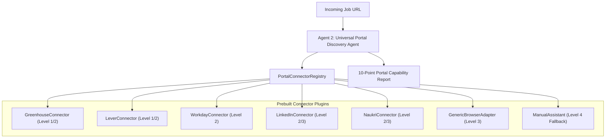

# Phase 5: Universal Job Portal Connector Architecture & Discovery Agent

## 1. Architectural Philosophy & Extensibility

Phase 5 implements the universal career portal connector subsystem and the **Universal Portal Discovery Agent (Agent 2)** for the **Universal Local-First AI Job Search and Application Agent**:

1. **Decoupled Plugin Architecture**: Core agent logic interacts exclusively with the abstract `JobPortalConnector` interface. New job platforms, ATS engines, or corporate websites are integrated as plugins without touching core application services.
2. **Four-Tier Integration Strategy**:
   - **Level 1: Official API**: Harvest API / Postings API when authorized public/partner endpoints exist.
   - **Level 2: ATS-Specific Integration**: Standardized Playwright DOM automation targeting Greenhouse, Lever, Workday, SmartRecruiters, Ashby, iCIMS, Taleo.
   - **Level 3: Generic Browser Adapter**: Heuristic DOM pattern matching traversing forms on unknown corporate career pages.
   - **Level 4: Assisted Manual Mode**: Activated when CAPTCHA, Cloudflare Turnstile, MFA, or anti-bot protections block automation. Prepares the tailored resume, pre-answers all detected questions, and assists the user in manual submission.
3. **Strict Compliance & Anti-Bot Rule**: The system never attempts to bypass CAPTCHA, MFA, or anti-bot security controls. If detected, it gracefully routes to Level 4 Assisted Manual Mode.
4. **Mandatory Human-in-the-Loop Token**: No connector can execute form submission without receiving a valid cryptographic approval token (`hitl_*`).

---

## 2. Universal Connector Hierarchy & Registry



---

## 3. Abstract Interface: 11 Mandatory Methods

Every connector implements `JobPortalConnector`:
1. `identify_portal(url: str) -> bool`: Identifies if a URL matches the connector's domain/patterns.
2. `check_support(url: str) -> PortalCapabilitiesSchema`: Returns operational capability flags.
3. `authenticate(credentials: Dict) -> bool`: Handles portal authentication via encrypted vault session.
4. `search_jobs(query: JobSearchQuery) -> List[JobListing]`: Executes targeted role searches.
5. `extract_job_details(target: str) -> JobDetails`: Extracts structured posting metadata.
6. `extract_job_description(target: str) -> str`: Extracts clean, unformatted JD text.
7. `prepare_application(job_id, profile) -> ApplicationFormData`: Pre-maps candidate facts to form inputs.
8. `fill_application(form_data) -> FillResult`: Automates form prefilling in browser.
9. `upload_resume(file_path: Path) -> bool`: Uploads tailored PDF/DOCX to file input.
10. `validate_application() -> ValidationReport`: Validates required fields and attachment presence.
11. `submit_application(approval_token: str) -> SubmissionConfirmation`: Submits form with required HITL token.

---

## 4. 10-Point Portal Capability Report Schema

When Agent 2 inspects any unfamiliar or known URL, it produces:

```json
{
  "portal_name": "Greenhouse Job Portal",
  "website": "https://boards.greenhouse.io",
  "ats_provider": "Greenhouse",
  "job_extraction_status": "SUPPORTED",
  "application_form_detection_status": "DETECTED",
  "resume_upload_support": true,
  "application_submission_support": true,
  "authentication_requirements": "NO (Public Application)",
  "security_restrictions": ["None Detected"],
  "unsupported_features": ["None identified"],
  "recommended_integration_approach": "LEVEL 2: ATS-Specific Integration. High compatibility: Structured extraction and automated form prefilling supported.",
  "active_connector_id": "greenhouse"
}
```

---

## 5. API Endpoints Reference

| Method | Endpoint | Description |
| :--- | :--- | :--- |
| `GET` | `/api/v1/portals/` | List all registered connectors and operational capability matrices. |
| `GET` | `/api/v1/portals/{portal_id}` | Get specific connector details. |
| `POST` | `/api/v1/portals/inspect` | Universal Portal Discovery Agent URL inspector. |

---

## 6. Verification & Testing

The test suite validates:
1. `test_portal_connector_registry_initialization`: Prebuilt connectors registered.
2. `test_dynamic_url_resolution`: Dynamic URL dispatch to Greenhouse, Lever, Workday, LinkedIn, Naukri, and Generic fallback.
3. `test_human_approval_token_mandatory_on_submission`: Strict rejection of submissions lacking valid cryptographic `hitl_*` token.
4. `test_portal_discovery_greenhouse_url`: Greenhouse inspection and ATS signature detection.
5. `test_portal_discovery_workday_url`: Workday inspection and multi-step wizard restriction reporting.
6. `test_portal_discovery_unknown_site`: Custom career page inspection and safe fallback recommendation.
7. `test_list_portals_endpoint` & `test_inspect_portal_endpoint`: End-to-end REST API validation.
